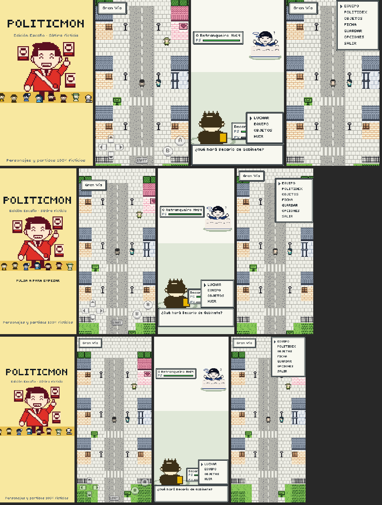

# POLITICMON

Juego para móvil (vertical) estilo Pokémon con políticos **ficticios**: fundas el Partido Nuevo en un
garaje, recorres Madrid, Andalucía y Galicia afiliando políticos, debates con militantes de partidos
rivales inventados y conquistas los tres Parlamentos (Escaños). Sátira amable: ningún personaje ni
partido representa a personas o partidos reales.

- Motor: **Godot 4.7.2** (GDScript), renderizador GL Compatibility, orientación vertical.
- Todo (código, datos, pixel art, fuente, música y efectos) está generado por este repositorio.
- Duración estimada: 45-60 minutos (`tools/balance.sh` simula una partida completa: ~53 min).



## Cómo jugar en escritorio

1. Instala Godot 4.7.x (binario oficial de https://godotengine.org/download).
2. Ejecuta desde la raíz del repo:
   ```bash
   godot --path .            # o abre project.godot con el editor y pulsa F5
   ```
   La primera vez Godot importa los assets (unos segundos).

Controles de teclado (también con mando):

| Acción | Teclas |
|---|---|
| Moverse | Flechas / WASD |
| A (aceptar, hablar) | Z, Intro, Espacio, J |
| B (cancelar, correr) | X, Retroceso, K, Mayús |
| START (menú) | Esc, M, Tab |

Con el ratón se pueden pulsar los controles táctiles en pantalla y las opciones de los menús.

## Cómo instalarlo en el móvil

### Android
- APK de depuración listos para instalar en `release/`: `politicmon-debug.apk` (armeabi-v7a + arm64-v8a)
  y `politicmon-debug-arm64.apk` (solo arm64, más ligero, válido para casi cualquier móvil actual).
- Instalar: copia el APK al móvil y ábrelo (permite «orígenes desconocidos»), o por USB:
  ```bash
  adb install -r release/politicmon-debug-arm64.apk
  ```
- Para regenerarlo necesitas las plantillas de exportación de Godot 4.7.2, un JDK 17+ y el
  Android SDK (o como mínimo `build-tools/<versión>/apksigner` y `platform-tools/adb`), configurados
  en *Editor Settings → Export → Android* junto con un keystore de depuración. Después:
  ```bash
  godot --headless --path . --export-debug "Android" build/politicmon.apk
  ```
  Para publicar, configura un keystore de release en el preset y usa `--export-release`.

### iOS
- El preset "iOS" exporta el **proyecto Xcode** (`build/ios/`). Compilar el `.ipa` requiere macOS con
  Xcode: abre `build/ios/Politicmon.xcodeproj`, elige tu equipo de firma (cambia
  `application/app_store_team_id` en `export_presets.cfg`) y ejecuta en tu dispositivo.

## Presentación en pantalla
- Resolución lógica dinámica con **escala entera pixel perfect** (stretch mode `viewport`, filtrado
  nearest). `ScreenScaler` elige el mayor factor entero que deja al menos 160x256 px lógicos y amplía el
  área visible al aspecto del dispositivo (más casillas, sin bandas).
- Respeta el *safe area* (notch, barra inferior): la UI se recoloca y el mapa sigue a pantalla completa.
- Controles táctiles semitransparentes (D-pad, A, B, START); se ocultan en menús y combates, donde
  se toca directamente cada opción (tocar fuera de un menú = B).

## Regenerar los assets

Requisitos: Python 3 con Pillow.

```bash
tools/build_assets.sh
```

| Script | Genera |
|---|---|
| `tools/data_politicians.py` | `data/politicians.json` (25 políticos) |
| `tools/gen_font.py` | Fuente bitmap 8x8 `assets/fonts/pixel8.fnt/.png` |
| `tools/gen_ui.py` | Marcos GBC, cursor, controles táctiles, plataformas, icono |
| `tools/art/gen_politician_sprites.py` | `NN_nombre_front/back/icon.png` + hojas de contacto |
| `tools/art/gen_trainer_sprites.py` | Rivales, líderes, jugador, mentora |
| `tools/art/gen_overworld_sprites.py` | Sprites 16x16 de overworld (4 direcciones x 2 frames) |
| `tools/gen_items.py` | Iconos de objetos y medallas Escaño |
| `tools/gen_tiles.py` | Tiles 8x8, metatiles 16x16 y `data/tiles.json` |
| `tools/gen_maps.py` | `data/maps/*.json` + vistas previas `docs/maps/*.png` |
| `tools/gen_audio.py` | Música y efectos chiptune (`assets/audio/*.wav`) |
| `tools/check_assets.py` | Valida tamaños y paletas de 4 colores |

Las paletas (4 colores por sprite/tile) están en `data/palettes.json`. Las hojas de contacto para
revisar el arte están en `docs/contact_sheets/`.

## Tests y herramientas

```bash
tools/run_tests.sh          # tests automatizados headless (tipos, daño, captura, EXP, guardado, mapas...)
tools/check_scripts.sh      # compila todos los scripts y muestra errores
tools/balance.sh            # simulación de equilibrado de una partida completa
tools/screenshot.sh battle_menu 1080x1920 shot.png   # captura real con Xvfb
```

Escenarios de depuración (`src/core/debug_scenarios.gd`) y piloto automático:
```bash
godot --path . -- --scenario=grass --autopress=a --inputs=left:2,right:2 --quit_after_inputs
```

## Estructura

```
data/        JSON: tipos (tabla de eficacias), movimientos, políticos, objetos, partidos,
             entrenadores, paletas, tiles y mapas — ampliables sin tocar código
src/core     autoloads: GameData, GameState, ScreenScaler, Router, entrada
src/battle   Politician, BattleLogic (fórmulas puras), BattleScene, objetos
src/overworld Overworld (mapa, movimiento, cámara), Actor, eventos
src/ui       diálogos, menús, pausa, Politidex, equipo, título, victoria, controles táctiles
src/save     guardado local JSON
src/audio    gestor de música/efectos
scenes/      main, title, overworld, victory
tests/       runner propio + tests
tools/       generadores de assets, simulador de equilibrado, scripts
```

Más detalle de arquitectura y fases en [PLAN.md](PLAN.md).
